  

  
  
  
  
  

  

▸ About me
const gabriel = {
  role: "Full Stack Developer",
  company: "Gardsoft",
  location: "Brazil 🇧🇷",
  availability: "Open to international remote opportunities 🌎",
  focus: ["Web & mobile applications", "SaaS products", "APIs", "Automation"],
  languages: ["Portuguese (native)", "English (learning)"],
  currently: "Building web platforms, mobile apps and business automations",
};
I build end-to-end digital solutions — from responsive interfaces and backend APIs to deployment, infrastructure and business automation. At Gardsoft, I work on websites, custom platforms, SaaS products and systems that solve real-world problems.
▸ Tech stack
Frontend & Mobile

Backend & Data

Infrastructure, Cloud & Tools

  
  
  
  

▸ Featured projects
<table>
<tr>
<td width="50%" valign="top">
<h3>🏛️ Coração Gaúcho</h3>

Full-stack event and ticketing ecosystem with a public site, administration dashboard, and TypeScript API.

<a href="https://github.com/tecchgardd/landpage_gdcoracaogaucho">Landing</a> · <a href="https://github.com/tecchgardd/painel_adm_gdcoracaogaucho">Admin</a> · <a href="https://github.com/tecchgardd/backend_coracaogaucho">API</a>

 
</td>
<td width="50%" valign="top">
<h3>🐟 MM Pescados</h3>

Online storefront, administrative dashboard, and backend for product and order management.

<a href="https://github.com/tecchgardd/frontend_loja_mmpescados">Store</a> · <a href="https://github.com/tecchgardd/frontend_page_admin">Admin</a> · <a href="https://github.com/tecchgardd/Mmpescado_backend">API</a>

 
</td>
</tr>
<tr>
<td width="50%" valign="top">
<h3>💎 <a href="https://github.com/tecchgardd/mht-marmoraria">MHT Marmoraria</a></h3>

Premium website for a marble and granite company, presenting its products and portfolio.

</td>
<td width="50%" valign="top">
<h3>🚀 <a href="https://github.com/tecchgardd/Plataforma-landinpage_gardsoft">Gardsoft Platform</a></h3>

Company platform showcasing digital services, solutions and projects.

 
</td>
</tr>
</table>▸ Explore all repositories
I maintain 33 repositories across web development, mobile applications, backend services, business automation and digital products.

  

The repository count above is manually set to 33. Update it when your portfolio grows; the GitHub repositories tab always shows your current accessible repositories.

▸ GitHub activity

  
  

  <b>Let's build something great together.</b>

Available for freelance projects and international remote opportunities.

